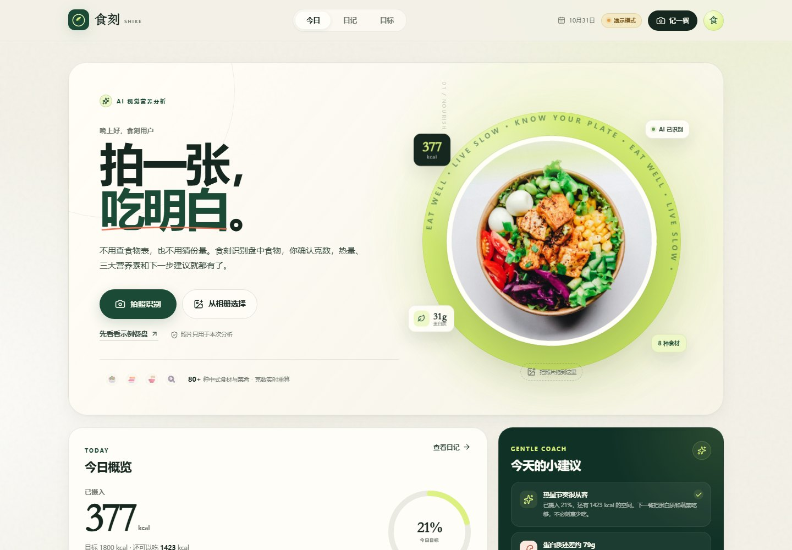
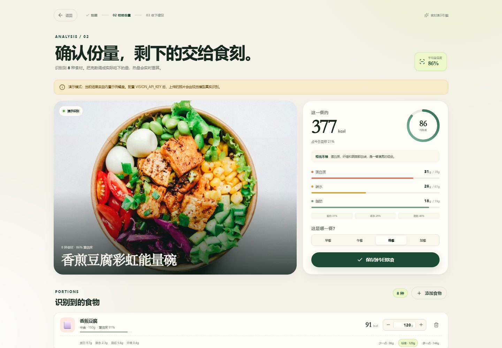
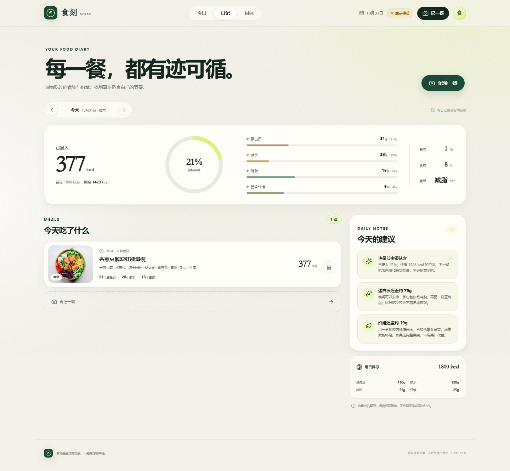
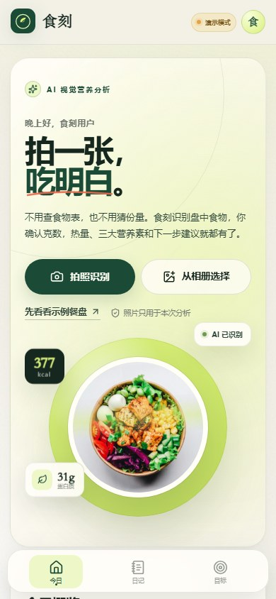
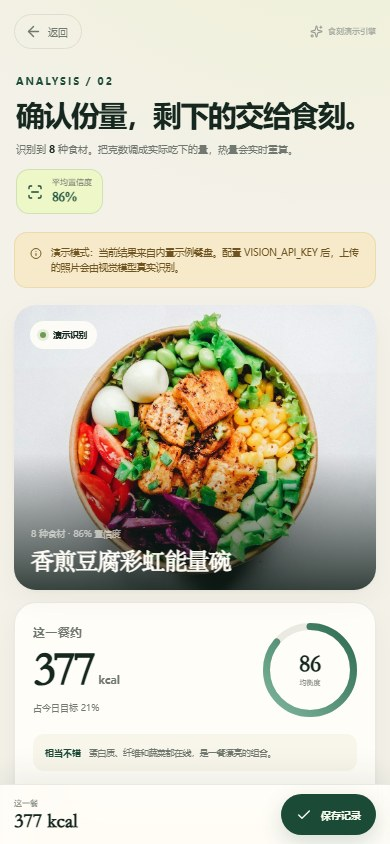

# 食刻 SHIKE

> 拍一张，吃明白。  
> AI 识别盘中食物，按克数实时计算热量与三大营养素，并给出这一餐真正可执行的调整建议。

食刻有**微信原生小程序**与 **Web / PWA** 两个客户端，共用同一套 API、食物库和营养引擎。上传或拍摄餐食照片后，视觉模型会拆解食材并估算份量；你只需要确认真实吃下的克数，热量、蛋白质、碳水、脂肪、膳食纤维、餐盘均衡度和建议都会实时更新。

> 以下截图为 Web/PWA 端，微信原生端沿用同一套设计语言与流程。



| 识别与克数校核 | 今日日记 |
| --- | --- |
|  |  |

<p align="center">
  
  
</p>

---

## 为什么是这套技术栈

目标是「一个人也能快速上线、识别可替换、营养计算可解释、移动端体验好」。因此没有为了“全栈框架”而引入重型服务，而是选择：

| 层 | 选择 | 原因 |
| --- | --- | --- |
| 微信端 | 原生 WXML / WXSS / JavaScript | 直接导入微信开发者工具；拍照、上传、Canvas 圆环、tabBar 均为原生能力 |
| Web 端 | React 19 + Vite 8 + TypeScript | 大屏验收、调试与分享；PWA 可直接添加到主屏幕 |
| 样式 | 原生 CSS Design Tokens | 无 UI 框架束缚，65KB CSS，视觉与响应式完全可控 |
| 后端 | Node.js 24 + Express 5 | 与前端同语言；Node 原生 TS type stripping，无需构建服务端 |
| 数据库 | `node:sqlite`（内置 SQLite） | 零外部依赖、单文件、事务完整，适合 MVP；可平滑迁移 PostgreSQL |
| 校验 | Zod 4 | 所有用户输入、模型 JSON、保存请求都有运行时边界 |
| 视觉模型 | 任意 OpenAI 兼容视觉模型 | 不绑定供应商；默认 `gpt-4.1-mini`，可换 Gemini 兼容网关、Qwen-VL 等 |
| 图片处理 | 浏览器 Canvas + 服务端魔数校验 | 上传前压缩到 1600px / ≤1.25MB，减少流量与模型成本 |
| 测试 | `node:test` | 零测试框架依赖，16 个单元/API/模型/小程序逻辑测试 |

**形态说明：** 微信原生客户端在 `miniprogram/`，用微信开发者工具导入仓库根目录即可；`project.config.json` 已指向 `miniprogram/`。默认使用 `touristappid` 与设备模式，配置 AppID 后启用微信登录。

---

## 功能

- **拍一张就识别**：相机拍摄或相册上传，自动压缩、识别、拆解混合菜肴。
- **每种食物都能改克数**：步进器、直接输入、±20% 快捷份量，热量与营养素实时重算。
- **可以补充漏识别食材**：内置 80+ 食物的搜索库，手动加入牛油果、米饭、鸡胸肉等。
- **不是只给一个热量数字**：同时给出蛋白质 / 碳水 / 脂肪 / 纤维、餐盘均衡度评分、三条针对当前目标的建议。
- **今日日记**：按天查看每一餐、全天摄入、目标完成度与剩余额度，可删除记录。
- **目标可调**：减脂 / 维持 / 增肌三套推荐值；填写性别、年龄、身高、体重和活动量后，会按 Mifflin-St Jeor 估算 BMR/TDEE 并自动生成目标，也可以手动覆盖。
- **无模型可体验**：未配置 API Key 时自动进入演示模式，使用内置示例餐盘完整走通流程。
- **微信登录可选**：配置 `WECHAT_APPID` / `WECHAT_SECRET` 后使用 `wx.login` + `openid` 会话；未配置时自动回落设备模式。
- **隐私边界清晰**：API Key 只在服务端；图片仅用于本次分析与你的记录。

---

## 快速开始

### 环境

- Node.js **24+**（使用原生 TypeScript type stripping 与 `node:sqlite`）
- npm 10+
- Windows / macOS / Linux 均可

### 安装与运行

```bash
npm install
cp .env.example .env      # Windows PowerShell: Copy-Item .env.example .env
npm run dev
```

打开：

- Web：<http://127.0.0.1:5173>
- API：<http://127.0.0.1:8787/api/health>

不填写 `VISION_API_KEY` 也能使用：会进入**演示识别模式**，配置后可切到真实视觉模型。

### 微信小程序

1. 保持 API 运行：`npm run dev:server`（或生产模式 `npm start`）。
2. 微信开发者工具 → 导入项目 → 选择**仓库根目录**。
3. 没有 AppID 时使用 `project.config.json` 里的 `touristappid`；真机/发布请换成自己的 AppID。
4. 详情 → 本地设置 → 勾选「不校验合法域名…」。
5. 首页点击「先看看示例餐盘」，走通识别 → 改克数 → 保存 → 日记。

真机调试时，把 `miniprogram/config.js` 的 `API_BASE` 改成电脑局域网 IP；正式发布必须使用 HTTPS 并配置 request / uploadFile / downloadFile 合法域名。

详见 [miniprogram/README.md](miniprogram/README.md)。

### 配置视觉模型

编辑 `.env`：

```dotenv
VISION_API_KEY=sk-...
VISION_BASE_URL=https://api.openai.com/v1
VISION_MODEL=gpt-4.1-mini
VISION_TIMEOUT_MS=45000
ALLOW_DEMO=true
```

微信登录（可选，不配置则小程序使用设备模式）：

```dotenv
WECHAT_APPID=wx...
WECHAT_SECRET=...
SESSION_SECRET=至少32位随机字符串
```

要求模型支持 **Chat Completions + image_url（data URI）**。服务端会自动尝试 JSON mode；如果兼容网关不支持 `response_format`，会再请求一次不带 JSON mode 的版本。

任何 OpenAI 兼容的视觉服务都可以接入，只需改 `VISION_BASE_URL` 和 `VISION_MODEL`。若供应商要求额外请求头，在 `server/services/vision.ts` 的请求处扩展即可。

> 生产环境建议把 `ALLOW_DEMO=false`，这样模型不可用时返回明确错误，而不是悄悄展示演示餐盘。

### 构建与生产运行

```bash
npm run build
npm start
```

生产模式由 Express 直接托管 `dist/`，访问 <http://127.0.0.1:8787>。数据库和上传图片在 `data/`。

### Docker

```bash
docker build -t shike .
docker run --rm -p 8787:8787 \
  -e VISION_API_KEY=sk-... \
  -v "$(pwd)/data:/app/data" \
  shike
```

---

## 常用脚本

| 命令 | 作用 |
| --- | --- |
| `npm run dev` | 同时启动 API（8787）与 Vite（5173） |
| `npm run dev:server` | 仅启动 API，支持 `node --watch` |
| `npm run dev:client` | 仅启动 Vite |
| `npm run build` | 类型检查 + 生产构建到 `dist/` |
| `npm start` | 生产模式启动，托管 `dist/` 与 API |
| `npm run typecheck` | `tsc --noEmit` |
| `npm run check:mini` | 校验小程序 JSON / JS / WXSS、页面文件和 tabBar 图标 |
| `npm test` | 16 个营养、建议、视觉解析、会话、API 与小程序逻辑测试 |

测试使用 `--test-isolation=none`，避免在受限环境里为每个测试文件创建子进程。

---

## 目录

```text
.
├─ miniprogram/             # 微信原生小程序（页面、组件、wx API 客户端）
├─ src/                     # React Web/PWA（页面、组件、API 客户端）
├─ server/                  # Express API、微信登录、识别适配器、SQLite
├─ shared/                  # 前后端共用的类型、计算、建议规则
├─ public/                  # 图标、PWA manifest、示例餐盘、社交封面
├─ docs/                    # 架构、API、微信运行文档与截图
├─ data/                    # 运行时数据（SQLite 与上传图片，gitignored）
├─ dist/                    # Web 生产构建产物
├─ project.config.json      # 微信开发者工具项目配置
├─ Dockerfile
├─ .env.example
└─ package.json
```

完整目录说明、数据流、ERD、API 契约与扩展路线见 **[docs/ARCHITECTURE.md](docs/ARCHITECTURE.md)**。

---

## API 一览

个人数据接口支持两种身份：

```http
Authorization: Bearer <微信登录会话 token>
# 或开发/Web 模式
x-device-id: <8–64 位设备 ID>
```

| 方法 | 路径 | 说明 |
| --- | --- | --- |
| GET | `/api/health` | 健康检查 |
| GET | `/api/meta` | 视觉模型 / 微信登录能力 |
| POST | `/api/auth/wechat` | `code` 换 `openid` 会话；未配置返回 501 |
| GET | `/api/profile` | 获取/初始化个人目标 |
| PUT | `/api/profile` | 更新昵称、目标与每日营养目标 |
| GET | `/api/foods?q=` | 搜索本地食物库 |
| POST | `/api/analyze` | 上传图片，返回识别结果（multipart，≤8MB） |
| POST | `/api/analyze/demo` | 无需上传，返回内置示例餐盘（小程序演示用） |
| GET | `/api/day?date=YYYY-MM-DD` | 某天的餐食、汇总、建议 |
| GET | `/api/meals?date=YYYY-MM-DD` | 某天的餐食列表 |
| POST | `/api/meals` | 保存一餐（服务端重算营养） |
| DELETE | `/api/meals/:id` | 删除记录 |

详细字段与示例见 [docs/API.md](docs/API.md)。

---

## 计算与边界

1. **营养值**来自本地食物库的每 100g 近似值；命中食物库时以本地值为准，未命中才使用模型估值。
2. **AI 负责“是什么”，你负责“多少”**。饮食记录保存时，服务端会重新根据克数与食物库计算，客户端提交的 totals 不作为可信数据。
3. **热量是估算**。烹调油、酱汁、隐藏糖和份量误差都会影响结果，产品用于趋势观察，不替代医疗或营养处方。
4. **模型输出不可信**。服务端用 Zod 校验结构、限制克数/营养值范围、限制条目数量的上限，并对未知食物降级到通用估值。

---

## 文档

- [架构与项目结构](docs/ARCHITECTURE.md)
- [API 契约](docs/API.md)
- [产品路线图与功能优先级](docs/ROADMAP.md)
- [微信小程序运行与发布](docs/WECHAT.md)
- [微信小程序客户端说明](miniprogram/README.md)
- [.env.example](.env.example)

---

## 已知限制与下一步

- 微信登录已实现；发布前必须确认真实 AppID、AppSecret 与 `SESSION_SECRET` 只存在于服务端 `.env`，不要提交到仓库。
- 设备模式下的历史记录不会自动归并到微信账号，上线前应补账号数据归并流程。
- SQLite 适合单实例 MVP；多实例部署请迁移 PostgreSQL，并把图片移到对象存储。
- 分析请求同步等待模型（3–8 秒）。流量上来后可改为任务队列 + WebSocket/轮询。
- 缺少历史趋势图、连续记录、餐次编辑与食物库后台管理。
- 视觉识别对复配菜、遮挡、俯拍角度和深色酱汁仍会出错，建议持续积累「用户实际克数」反馈并建立评测集。

这些不是“以后再说”的空话：数据表、服务边界与 API 已经按可迁移的方向切分，替换存储或模型不会影响微信端或 Web 端契约。
