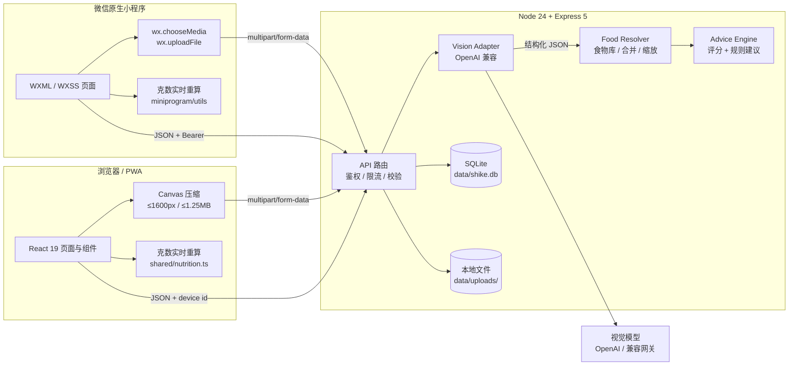
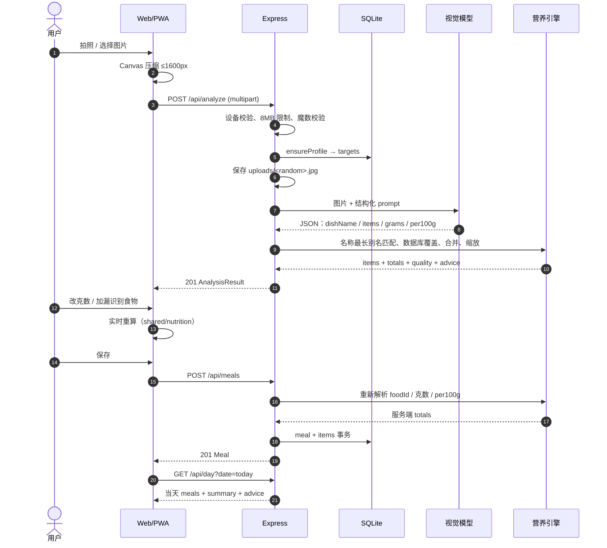
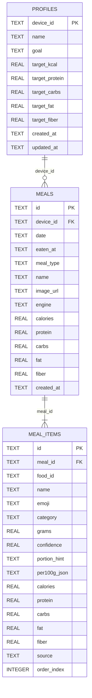

# 食刻 SHIKE — 架构与项目结构

> 版本：v1.1  
> 定位：AI 食物识别 / 克数校核 / 营养建议，微信原生小程序 + Web/PWA 双端  
> 最后更新：2026-10

---

## 1. 产品边界

用户只做三件事：

1. 拍一张餐食照片；
2. 确认识别出的食物与克数；
3. 得到热量、营养素和一餐建议，并把记录留在日记里。

系统负责：

- 在微信端或浏览器内压缩图片；
- 调用视觉模型识别食材、拆解复合菜、估算份量；
- 将模型结果与本地营养库对齐；
- 按可食克数实时计算营养；
- 根据每日目标生成可解释的建议；
- 以「微信 openid」或匿名设备为边界保存每日记录。

**不负责**：疾病诊断、营养处方、精确到实验室级的热量测量、社交/排行榜。所有输出都明确标注为估算。

---

## 2. 关键架构决策

| 决策 | 选择 | 理由 | 代价 |
| --- | --- | --- | --- |
| 交付形态 | 微信原生 + Web/PWA 双端 | 微信是主入口；Web 用于大屏验收、调试与分享；共用 API | 两套客户端 UI，营养规则需保持同步 |
| 微信端 | 原生 WXML / WXSS / JS | 相机、上传、Canvas、tabBar 均为原生能力；可直接导入开发者工具 | 不能复用 React 组件 |
| Web 端 | React 19 + Vite 8 + TS | 组件化、构建快、运行时包 92KB gzip | 需要自己维护设计系统 |
| 样式 | 原生 CSS + tokens | 完全控制布局、动效、响应式；65KB CSS | 没有现成组件库 |
| 服务端 | Node 24 + Express 5 | 与前端共享 TS 类型；Node 原生执行 TS，无服务端构建链 | Express 5 生态相对轻量 |
| 数据库 | `node:sqlite` | 单文件、零服务、WAL、事务；MVP 足够 | 单写者、不适合多实例横向扩展 |
| 验证 | Zod 4 | 模型 JSON 与用户输入都需要运行时校验 | schema 需要跟随 API 演进 |
| 视觉 | OpenAI 兼容接口 | 供应商可替换；价格/能力可随业务调整 | 需要自行处理兼容差异 |
| 识别结果 | 不落库的分析快照 | 用户校核期间可随意改；只有确认后才保存 | 刷新页面会丢未保存分析 |
| 保存 | 服务端重算 | 防止客户端篡改 totals；保证历史记录一致 | 保存请求需要提交 per100g 与 foodId |

### 为什么不直接上 Next.js

本项目是**单一移动端产品 + 少量 API**，没有 SEO 页面、RSC 数据流或团队协作路由需求。Vite SPA + Express 的边界更简单，部署只需要一个 Node 进程和静态目录；同时避免把数据库、文件上传与模型调用绑定到某个托管平台的运行时。

### 为什么不用 PostgreSQL / Prisma

MVP 是单用户、单实例、低并发，SQLite 的事务与索引已经足够，且没有额外服务可挂。`Store` 是唯一的数据访问层，迁移 PostgreSQL 时只需替换这一层，API 与前端契约不变。

---

## 3. 系统架构



### 运行时拓扑

```text
微信开发者工具 / 真机
  └─ miniprogram/ ── wx.request / wx.uploadFile ──▶ 127.0.0.1:8787 Express
127.0.0.1:5173  Vite dev server ──proxy /api──▶ 127.0.0.1:8787 Express
                                                         │
                                                         ├─ data/shike.db
                                                         ├─ data/uploads/
                                                         ├─ https://api.weixin.qq.com/sns/jscode2session
                                                         └─ https://<vision-provider>/v1/chat/completions
生产：
127.0.0.1:8787  Express ── static dist/ + /api + /uploads
```

Web 端没有 CORS：开发期 Vite 代理，生产期同源。微信端不受浏览器 CORS 限制，但受小程序「合法域名」与 HTTPS 约束。

---

## 4. 目录结构

```text
shike/
├─ miniprogram/                      # 微信原生小程序
│  ├─ app.js / app.json / app.wxss
│  ├─ config.js                      # API 地址 / 是否启用微信登录
│  ├─ utils/
│  │  ├─ api.js                      # wx.request / uploadFile / 会话
│  │  ├─ nutrition.js                # 与服务端一致的 JS 计算
│  │  ├─ advice.js                   # 评分与建议规则
│  │  ├─ format.js                   # 日期/时间/问候
│  │  └─ constants.js
│  ├─ components/
│  │  ├─ progress-ring/              # Canvas 2D 圆环
│  │  ├─ macro-bar/
│  │  └─ advice-card/
│  ├─ pages/
│  │  ├─ home/                       # 今日、拍照、示例、最近记录
│  │  ├─ review/                     # 克数校核、补食物、保存
│  │  ├─ food-search/                # 食物库搜索
│  │  ├─ journal/                    # 日记、日期切换、删除
│  │  └─ goals/                      # 昵称、模式、每日目标
│  └─ images/                        # tabBar 图标、示例餐盘、logo
│
├─ src/                              # React Web/PWA
│  ├─ main.tsx                       # React 入口
│  ├─ App.tsx                        # 应用状态、路由式 tab、保存/删除编排
│  ├─ styles.css                     # 设计系统 + 全部响应式样式
│  ├─ types.ts                       # 仅前端使用的 UI 类型
│  ├─ components/
│  │  ├─ Header.tsx                  # 桌面导航 / 品牌 / 记录入口
│  │  ├─ BottomNav.tsx               # 移动端底部导航 + 悬浮拍摄按钮
│  │  ├─ Logo.tsx                    # 品牌标记（内联 SVG）
│  │  ├─ ProgressRing.tsx            # 热量/均衡度圆环
│  │  ├─ MacroBar.tsx                # 三大营养素/纤维进度条
│  │  ├─ AdviceCard.tsx              # 建议卡（按 kind 映射图标）
│  │  ├─ MealCard.tsx                # 日记中的一餐
│  │  ├─ GramControl.tsx             # 克数步进器 + 直接输入
│  │  ├─ FoodSearchSheet.tsx         # 补充漏识别食物的底部抽屉
│  │  ├─ AnalyzeOverlay.tsx          # 识别中的扫描态
│  │  ├─ EmptyState.tsx
│  │  └─ Toast.tsx
│  ├─ screens/
│  │  ├─ HomeScreen.tsx              # Hero、今日概览、最近记录、拍摄技巧
│  │  ├─ ReviewScreen.tsx            # 识别结果、克数校核、实时建议、保存
│  │  ├─ JournalScreen.tsx           # 按天回看、日均汇总、删除
│  │  └─ GoalsScreen.tsx             # 昵称、目标模式、每日营养目标
│  └─ lib/
│     ├─ api.ts                      # fetch 封装、设备 ID、错误类型
│     ├─ image.ts                    # Canvas 压缩（EXIF 方向、质量回退）
│     └─ format.ts                   # 日期、时间、问候语
│
├─ server/                           # 后端
│  ├─ index.ts                       # 读取 env、建库、listen、优雅退出
│  ├─ app.ts                         # createApp：路由、中间件、静态托管
│  ├─ config.ts                      # 环境变量 → 强类型 AppConfig
│  ├─ store.ts                       # SQLite schema、事务、查询
│  ├─ data/
│  │  ├─ foods.ts                    # 80+ 食物营养库、别名匹配、搜索
│  │  └─ demo.ts                     # 与示例图片对应的演示餐盘
│  ├─ lib/
│  │  ├─ errors.ts                   # AppError（status / code / details）
│  │  └─ image.ts                    # 魔数检测、随机文件名写入
│  ├─ services/
│  │  ├─ vision.ts                   # 模型调用、JSON 解析、降级
│  │  ├─ items.ts                    # 模型结果 → FoodItem、合并、汇总
│  │  └─ analysis.ts                 # 组装 AnalysisResult + 评分 + 建议
│  └─ tests/
│     ├─ nutrition.test.ts
│     ├─ suggestions.test.ts
│     ├─ vision.test.ts              # 本地 mock OpenAI 兼容服务
│     └─ api.test.ts                 # 识别→保存→汇总→删除全链路
│
├─ shared/                           # 前后端共用，无 Node/DOM 依赖
│  ├─ types.ts                       # 领域模型 / API 类型
│  ├─ nutrition.ts                   # 缩放、汇总、宏量供能、日期、餐次
│  └─ advice.ts                      # 餐盘评分、一餐建议、每日建议
│
├─ public/
│  ├─ favicon.svg
│  ├─ manifest.webmanifest           # PWA
│  ├─ sw.js                          # 静态壳缓存，不缓存 API / 用户图片
│  ├─ icons/                         # 192/512/maskable/apple-touch
│  └─ images/
│     ├─ demo-bowl.jpg               # 示例餐盘（本地，不依赖外网）
│     └─ og-cover.jpg                # 社交分享封面
│
├─ docs/
│  ├─ ARCHITECTURE.md                # 本文
│  ├─ API.md                         # API 契约
│  ├─ WECHAT.md                      # 微信小程序迁移
│  └─ screenshots/
│
├─ data/                             # 运行时（gitignored）
│  ├─ shike.db
│  └─ uploads/                       # 用户图片
│
├─ Dockerfile
├─ vite.config.ts
├─ tsconfig.json
├─ package.json
└─ .env.example
```

---

## 5. 前端架构

### 5.1 页面与状态

没有引入 Redux/Zustand：页面层级浅，状态只在一个 `App` 中。

```text
App
├─ meta                  服务端能力（是否配置视觉）
├─ profile               昵称 / 目标 / 每日 targets
├─ todaySummary          今日的 DaySummary
├─ journalDate + summary 日记选中的日期与数据
├─ analysis              当前未保存的分析结果
├─ scanning + previewUrl 识别中的 UI 状态
└─ toast
```

`Tab = "home" | "journal" | "goals"` 是轻量“路由”。进入识别结果时整个应用切换到全屏 `ReviewScreen`，隐藏全局 Header 与底部导航，避免用户在校核过程中被导航打断。

### 5.2 数据流

1. **启动**：并行 `GET /api/meta` 与 `GET /api/day?date=today`；失败显示可重试的错误页。
2. **选图**：`URL.createObjectURL` 先显示预览 → `compressImage` → `POST /api/analyze`。
3. **校核**：`ReviewScreen` 内部维护 `items`；`useMemo` 计算 totals / quality / advice，不再请求服务端。所有计算来自 `shared/`，与服务端一致。
4. **保存**：提交 `items` 的 foodId、克数、per100g 等；服务端重新计算并落库。
5. **日记**：`GET /api/day` 获取某日 meals + totals + advice。切换日期时清空旧 summary 并显示 loading。
6. **删除**：`window.confirm` → `DELETE` → 同时刷新日记和今日概览。

### 5.3 设计系统

- 颜色：燕麦底色 `#F3F1E8`、纸白 `#FFFDF7`、深绿 `#1B4B37`、青柠 `#D9EF7C`、珊瑚 `#ED6B4C`。
- 字体：系统 Inter / PingFang / 微软雅黑；大数字和标题使用衬线 `Iowan Old Style / Songti SC`，形成“食物杂志”感。
- 结构：12 列宽度的 editorial hero、纸张卡片、细描边、低对比阴影、极轻噪点。
- 响应式断点：1100 / 980 / 860 / 700 / 390。860 以下切换为底部导航；识别页使用固定底部保存条。
- 动效：仅用于表达状态（扫描、圆环、页面进入、浮动标签），并遵守 `prefers-reduced-motion`。

### 5.4 图片压缩

`src/lib/image.ts`：

- 支持 JPG / PNG / WebP；HEIC 明确提示用户截图后上传。
- `createImageBitmap(file, { imageOrientation: "from-image" })` 处理手机 EXIF 旋转，失败回退 ``。
- 长边限制 1600px，JPEG 质量从 0.86 逐步降到 0.55，直到 ≤1.25MB。
- 先铺米色底再绘制，避免透明 PNG 变黑。
- 服务端仍然独立校验 8MB 上限与文件魔数，不信任前端。

### 5.5 微信原生客户端

`miniprogram/` 不依赖 npm 构建，直接导入微信开发者工具。

**页面与原生能力：**

| 页面 | 原生能力 |
| --- | --- |
| `pages/home` | `wx.chooseMedia` 拍照/相册、`wx.request` 今日数据、tabBar |
| `pages/review` | 本地克数重算、固定底部保存条、`wx.uploadFile` 结果展示 |
| `pages/food-search` | `wx.request` 搜索食物库，返回上一页时通过 `globalData.pendingFood` 传递 |
| `pages/journal` | 日期切换、`wx.showModal` 删除、下拉刷新 |
| `pages/goals` | `wx.request` 更新 profile、目标预设 |

**小程序内状态：**

```text
App.globalData
├─ authReady       wx.login → /api/auth/wechat 的 Promise
├─ analysis        home 识别后交给 review 的未保存结果
├─ suggestedMealType
├─ pendingFood     food-search → review 的食物
├─ lastSaved       保存后交给 journal 显示 toast
└─ profile         目标与昵称缓存
```

**登录：**

```text
App.onLaunch
  → api.ensureDeviceId()
  → wx.login()
  → POST /api/auth/wechat { code }
  → 服务端 code2Session
  → wx.setStorageSync("shike.session.v1", token)
  → 后续 wx.request / wx.uploadFile 使用 Authorization: Bearer
```

未配置 `WECHAT_APPID` / `WECHAT_SECRET` 时，服务端返回 501，小程序自动使用 `x-device-id`，因此本地无需 AppID 也能完整跑通。

**与 Web 端的重复：**

- `miniprogram/utils/nutrition.js` 和 `advice.js` 是 `shared/*.ts` 的 CommonJS 版本。
- 小程序不能直接 import TypeScript/共享 ESM，因此保留两份纯规则；`server/tests/miniprogram.test.ts` 会校验核心计算一致，并要求建议始终三条。
- 修改营养/评分规则时，必须同步 `shared/` 与 `miniprogram/utils/`；API 仍以服务端保存时重算为准。

**圆环：** `components/progress-ring` 使用 Canvas 2D + `wx.createSelectorQuery()`，支持 DPR、三种色调和 slot 中心内容。

---

## 6. 后端架构

### 6.1 分层

```text
HTTP 请求
  ↓
app.ts
  ├─ express.json / multer（内存）
  ├─ getDeviceId（x-device-id 校验）
  ├─ analyze 限流（20 次 / 10 分钟 / 设备）
  ├─ Zod 请求校验
  └─ 路由
       ├─ analyze → image 魔数 → saveImage → vision → analysis
       └─ meals   → Zod → makeFoodItem → itemsTotal → Store.insertMeal
  ↓
services/                  纯业务
  ├─ vision.ts             外部模型边界
  ├─ items.ts              结果归一化
  └─ analysis.ts           组装 + 评分 + 建议
  ↓
store.ts                   SQLite，唯一数据访问入口
```

所有路由用 `asyncRoute` 包装，异常统一交给错误中间件。`createApp({ config, store })` 支持注入临时数据库，因此 API 测试不需要启动真实服务或触碰开发数据。

### 6.2 数据访问

`Store` 使用 `node:sqlite` 的同步 API：

- `PRAGMA journal_mode = WAL` 提升读写并发；
- `PRAGMA foreign_keys = ON`；
- `insertMeal` 使用 `BEGIN IMMEDIATE / COMMIT / ROLLBACK` 保证 meal 与 items 原子性；
- 所有 SQL 使用 prepared statement 参数绑定；
- `meals(device_id, date, eaten_at)` 与 `meal_items(meal_id, order_index)` 有索引。

### 6.3 静态资源

- 开发：Vite 提供页面与 `/images`，代理 `/api`、`/uploads` 到 8787。
- 生产：Express 托管 `dist/`，`/uploads` 使用 `immutable` 缓存，SPA fallback 到 `index.html`。
- `/uploads` 文件名是 `时间戳-随机 UUID.ext`，不可枚举；图片 URL 只接受 `/uploads/` 与 `/images/` 前缀，防止保存外部 URL。

---

## 7. 核心链路

### 7.1 识别 → 校核 → 保存



### 7.2 失败与降级矩阵

| 情况 | 行为 | 用户看到 |
| --- | --- | --- |
| 未配置 `VISION_API_KEY` | 返回内置演示餐盘 | 黄色提示条「演示模式」 |
| 模型超时 / 网络错误 | 若 `ALLOW_DEMO=true` 降级演示 | 提示「已切换到演示餐盘」 |
| 模型返回非 JSON / 结构错误 | 抛 `VISION_SCHEMA`，走降级 | 同上 |
| 429 限流 | 降级或 429（生产 `ALLOW_DEMO=false`） | 明确错误文案 |
| 图片 >8MB / 非 JPG-PNG-WebP | 400/413/415 | 中文错误 |
| 需求设备 ID 缺失 | 400 `DEVICE_REQUIRED` | 请求失败 |
| 单身份识别 >20 次 / 10 分钟 | 429 | 「休息 10 分钟再试」 |

---

## 8. 视觉识别设计

### 8.1 Prompt 约束

`server/services/vision.ts` 的系统提示词要求：

- 只输出 JSON；
- 识别 1–10 种可见食物；
- 混合菜按主要食材拆开；
- `grams` 是**这一份可食部分熟重**，范围 1–3000；
- `per100g` 是每 100g 的热量、蛋白质、碳水、脂肪、纤维；
- `category` 限定 9 类；
- 不确定时降低 confidence，不虚构不可见食物；
- 明显可见的油、酱汁、糖要计入。

请求使用 `detail: "low"` 控制视觉 token 成本，`temperature: 0.2` 降低随机性，`max_tokens: 1600`。

### 8.2 结构化校验

Zod schema 限制：

- dishName ≤40 字；
- items 1–12 条；
- grams 1–3000；
- kcal 0–900 / 100g，蛋白/碳水/脂肪/纤维 0–100 / 100g；
- confidence 0–100，>1 时归一化为 0–1；
- category 非法值自动落到 `other`。

### 8.3 与营养库对齐

`server/services/items.ts` 的 `makeFoodItem`：

1. 如果客户端/模型给出 `foodId`，优先按 ID 命中；
2. 否则用 `resolveFood(name)` 做最长别名匹配（去空格、括号、标点）；
3. 命中营养库 → 使用库中 per100g，`source = "database"`，并沿用库的 emoji/category/份量提示；
4. 未命中 → 使用模型 per100g，`source = "ai"`，前端显示「模型估值」；
5. 两者都没有 → 通用值 150kcal / 8P / 15C / 6F / 1.5 fiber，避免 0 热量；
6. 同一 `foodId`（或未命中时同名）合并，克数相加，取较高置信度；
7. 名称保留模型识别到的具体做法（如「香煎豆腐」），营养以库值为锚，减少“识别名被改写”的割裂感。

### 8.4 为什么保存时重算

客户端可以改克数、加食物、删食物，因此提交的 items 是不可信输入。保存接口会再次：

- 限制 1–20 条；
- 每条 1–3000g；
- 校验 per100g 数值范围；
- 重新按 foodId/名称命中库；
- 重新求和；
- 才写 `meals` 与 `meal_items`。

这使得历史记录不会因为前端 bug 或参数篡改而出现“两条记录相同食物但营养不同”的问题。

---

## 9. 营养与建议引擎

### 9.1 营养计算

`shared/nutrition.ts` 是前后端共用的纯函数：

```ts
scaleNutrition(per100g, grams) = per100g × grams / 100
sumNutrition(items)            = 逐项求和，1 位小数
macroEnergy(totals)            = P×4 / C×4 / F×9 的供能占比
caloriePercent(consumed, target)
localDateKey(timeZone = "Asia/Shanghai")
inferMealType(date)
```

前后端使用同一份函数，保证：

- 用户拖动克数时立即看到与服务端一致的结果；
- 保存后的 totals 与识别页一致；
- 测试可以只测纯函数。

### 9.2 餐盘质量分

`buildPlateQuality` 不是医学指标，而是一个可解释的相对分数：

```text
基础 43
+ 蛋白质达标度（相对一餐目标 35% 的每日蛋白） × 24
+ 纤维（目标 7g/餐） × 16
+ 蔬菜/水果种类（最多 3 种） × 10
− 脂肪供能 > 42% 时 9 分
− 热量 > 一餐预算 155% 时 8 分
− 热量 < 一餐预算 45% 时 5 分
最终 clamp 到 30–98
```

标签：≥88 非常均衡 / ≥75 相当不错 / ≥60 还有提升空间 / 否则需要调整。

### 9.3 建议规则

`buildMealAdvice` 和 `buildDailyAdvice` 是确定性规则，不依赖模型，因此：

- 没有视觉模型也能给建议；
- 同一输入结果稳定；
- 成本为零；
- 可以单元测试。

一餐建议覆盖：份量偏大、蛋白质不足、纤维/蔬菜不足、脂肪供能过高、搭配均衡、饮水、进食速度。始终返回 3 条，按优先级去重。

每日建议覆盖：热量剩余/超标、蛋白质差距、纤维差距、无记录时的起步建议。

---

## 10. 数据模型



设计说明：

- `profiles.device_id` 当前是设备标识；生产环境应改为 `users.id` 并在服务端建立设备→用户映射。
- `meals` 存汇总值，避免日记列表每次重新求和；`meal_items` 存明细与 `per100g_json` 快照，保证历史可解释。
- `date` 是查询键（YYYY-MM-DD），`eaten_at` 是完整时间；客户端选择日期，服务端默认使用上海时区。
- `source` 区分 `database` / `ai`，便于前端展示「模型估值」和后续质量分析。
- `engine` 记录本次使用的模型名或「演示引擎」，用于问题追踪。

---

## 11. API 契约

完整定义（请求/响应/错误码）见 **[API.md](API.md)**。总览：

```text
GET    /api/health
GET    /api/meta
POST   /api/auth/wechat      { code } → token（未配置返回 501）
GET    /api/profile
PUT    /api/profile
GET    /api/foods?q=
POST   /api/analyze          multipart/form-data, field=image
POST   /api/analyze/demo     内置示例餐盘
GET    /api/day?date=YYYY-MM-DD
GET    /api/meals?date=YYYY-MM-DD
POST   /api/meals            application/json
DELETE /api/meals/:id
```

个人接口支持微信会话或开发设备 ID：

```http
Authorization: Bearer <session token>
# 或
x-device-id: 8d1f0c2e-...
```

微信 token 是 HMAC-SHA256 签名的 `{sub, iat, exp, v}`，默认 30 天有效；`sub` 为 `wx_<openid>`。

错误统一：

```json
{
  "error": "可直接展示给用户的中文说明",
  "code": "MACHINE_READABLE_CODE",
  "details": {}
}
```

---

## 12. 安全与隐私

| 面 | 措施 |
| --- | --- |
| 密钥 | `VISION_API_KEY`、`WECHAT_SECRET`、`SESSION_SECRET` 只在服务端 |
| 微信登录 | `wx.login` code → 服务端 `code2Session` → HMAC 签名会话；客户端不接触 AppSecret/openid 签发逻辑 |
| 会话 | token 30 天有效，包含 `sub/iat/exp`；服务端 timing-safe 校验，篡改/过期返回 401 |
| 设备模式 | `x-device-id` 是匿名标识，可伪造；仅适合开发/无账号场景，不能作为强认证 |
| 上传 | 8MB 上限、单文件、MIME + 魔数双重校验、随机文件名 |
| 路径 | 不拼接用户文件名；图片 URL 仅允许 `/uploads/` 或 `/images/` |
| SQL | 全部 prepared statement；无字符串拼接 |
| XSS | Web 端 React 默认转义；小程序 WXML 文本绑定；模型输出不渲染 HTML |
| CSRF | 无 cookie 会话；Web 同源 JSON，小程序使用自定义 header |
| 限流 | `/api/analyze` 单身份 20 次/10 分钟（内存实现） |
| 数据隔离 | 所有查询强制 `device_id = ?`（微信身份为 `wx_<openid>`）；删除记录校验归属 |
| 模型输入 | 图片可能包含文字，模型可能被图像内容影响；结构化 schema 与数量/数值边界限制影响面 |
| 日志 | 不打印 API Key；上游错误只落截断后的状态码与文本 |
| 敏感信息 | `.env`、`data/` 全部 gitignored |

**隐私说明（需要在上线时明确告知用户）**：图片会发送给你配置的视觉模型供应商，其数据使用政策取决于该供应商。生产环境应选择支持“不用于训练”的企业 API，签署 DPA，并在隐私政策中说明保存期限与删除方式。当前实现不会主动把图片用于训练。

**删除**：删除餐食会级联删除 items，但不会自动删除已上传的图片文件（因为可能被其他记录引用）。生产环境应增加孤儿图片清理任务。

---

## 13. 性能与可靠性

| 项 | 现状 | 说明 |
| --- | --- | --- |
| 前端 bundle | 295KB JS / 92KB gzip；65KB CSS / 13KB gzip | 无 UI 框架，图标按需 tree-shake |
| 首屏 | 静态 HTML + 单 JS；图片懒加载 | 示例图 215KB，已压缩 |
| 离线 | Service Worker 缓存应用壳与示例图 | API、用户上传、分析结果永不缓存 |
| 图片上传 | 浏览器压缩至 ≤1600px / ≤1.25MB | 降低移动网络流量与模型 token |
| 模型延迟 | 同步调用，通常 3–8s；45s 超时 | 扫描态给出步骤反馈 |
| 数据库 | WAL + 两个索引 | 单实例低并发足够 |
| 读取 | 一次 `/api/day` 返回 meal + items + summary | 减少往返 |
| 故障 | 模型失败可降级演示；API 失败有重试页 | 不会白屏 |
| 限流 | 内存 Map | 多实例需换 Redis |

**扫描期间**：全屏遮罩 + 图片 + 4 个阶段文案；成功后 420ms 过渡到结果页，避免闪烁。

**上传图片**：当前同步写盘后调用模型，最坏情况请求占用一个 Node 连接 45 秒。生产高并发应改为任务队列（BullMQ / SQS）并返回 jobId。

---

## 14. 测试

`npm test` 运行 16 个测试：

| 文件 | 覆盖 |
| --- | --- |
| `nutrition.test.ts` | 克数缩放、汇总、宏量供能、时区日期/餐次、评分边界 |
| `suggestions.test.ts` | 建议始终 3 条、蛋白不足提示、空日记/有记录 |
| `vision.test.ts` | 本地 mock OpenAI 兼容服务、Authorization、JSON 解析、字段归一化 |
| `session.test.ts` | 会话签名、篡改、过期 |
| `miniprogram.test.ts` | 小程序页面/组件加载、营养计算与建议规则一致性 |
| `api.test.ts` | 设备/Token 鉴权、profile 更新、食物搜索、Demo、分析→保存→汇总→删除 |

测试使用真实 SQLite 临时库和真实 HTTP server，不 mock 数据层。`--test-isolation=none` 让测试在单进程内运行，适配受限的 CI/沙箱环境。

浏览器验收脚本（开发期使用 Playwright 连接本机 CDP）覆盖：

- 示例餐盘识别；
- 克数修改后 377 → 423 kcal 实时重算；
- 添加牛油果后 9 种食材；
- 保存后日记 551 kcal；
- 目标切换与保存；
- 删除记录；
- 390px 移动端布局与识别页；
- 0 console error / pageerror。

---

## 15. 部署

### 单实例（推荐 MVP）

```bash
npm ci
npm run build
NODE_ENV=production npm start
```

- 进程：1 个 Node。
- 持久化：挂载 `data/`。
- 反向代理：Nginx/Caddy 终止 TLS，转发 8787。
- 必需环境变量：`VISION_API_KEY`、`VISION_BASE_URL`、`VISION_MODEL`、`ALLOW_DEMO=false`。
- 健康检查：`GET /api/health`。
- 备份：定时复制 `data/shike.db`（先 `sqlite3 .backup` 或停写）与 `data/uploads/`。

### Docker

`Dockerfile` 采用两阶段：

1. `node:24-bookworm-slim` 安装依赖并 `npm run build`；
2. 运行时只复制 `dist/`、`server/`、`shared/`、`public/` 与生产依赖，`node` 用户运行，挂载 `/app/data`。

### 平台选择

- **Railway / Fly.io / Render / VPS**：有持久磁盘，适合 SQLite + 本地图片。
- **Vercel / Netlify**：不适合当前 SQLite/本地文件实现，需要换 Postgres + 对象存储。
- **微信云托管**：可作为 API 部署目标，图片改对象存储，数据库换云数据库。

---

## 16. 扩展到生产

### 16.1 账号与多端

- 微信小程序：`wx.login` → 服务端 `code2Session` → `openid` → 内部 `user_id` → 签发短期 JWT。
- Web/PWA：邮箱魔法链接或微信扫码登录。
- `x-device-id` 仅作为匿名设备标识；登录后把该设备的历史记录归并到账号。

### 16.2 存储

- SQLite → PostgreSQL / Supabase：
  - 新建 `users`，`meals.user_id`；
  - 把 `Store` 替换为 repository；
  - 保留 `meal_items.per100g_json`；
  - 用迁移脚本回填。
- 本地 `uploads/` → S3/R2/OSS：
  - 服务端生成预签名 URL 或直传；
  - 数据库存 object key；
  - 用 CDN 输出。

### 16.3 识别质量

- 建立 200–500 张带人工标注（食材/克数）的中餐评测集；
- 指标：食材召回率、克数 MAE、热量 MAE、复合菜拆解准确率；
- 保存用户最终克数作为弱标注，离线评估“模型初值 vs 用户修正值”；
- 对高频菜建立菜谱组合（如「番茄炒蛋」= 番茄 + 蛋 + 油），减少逐图误差；
- 引入份量参照（餐具、手掌）或多视角照片。

### 16.4 体验

- 历史趋势（7 天/30 天热量、蛋白质、体重）；
- 餐次编辑（当前只能删除重记）；
- 连续记录与温和提醒；
- 周报：平均蛋白、蔬菜多样性、外食比例；
- 食物库后台与自定义食物。

---

## 17. 微信小程序

原生客户端已实现于 `miniprogram/`，包含：

- 5 个页面（今日 / 校核 / 食物搜索 / 日记 / 目标）；
- 3 个自定义组件（Canvas 圆环、营养素条、建议卡）；
- `wx.chooseMedia`、`wx.uploadFile`、`wx.request`、`wx.login`；
- 原生 tabBar 与 81×81 图标；
- 微信登录失败时自动回落设备模式。

运行、导入、域名、登录配置与上线检查见 **[WECHAT.md](WECHAT.md)** 和 **[../miniprogram/README.md](../miniprogram/README.md)**。

---

## 18. 已知限制

1. **份量估算本质不确定**：单张照片无法知道盘子的真实尺寸、食物密度和实际吃下比例；产品用“用户确认克数”把最终决定权交还给用户。
2. **中餐复合菜**：模型可能把“鱼香肉丝”识别成猪肉+胡萝卜+木耳，营养库按食材近似，油和糖容易低估。
3. **同步请求**：45 秒超时是高延迟上限，不是目标；高并发必须队列化。
4. **设备模式不跨设备**：微信登录已实现，但未登录/未配置 AppID 时仅以本地设备标识保存；设备模式历史不会自动归并到微信账号。
5. **无图片清理**：删除记录不删文件，需要后台任务。
6. **演示模式不是识别**：未配置 Key 时展示的是固定示例餐盘，UI 已明确提示，不能当作真实结果。
7. **医疗边界**：所有建议为一般性饮食提示，不构成诊断或治疗建议。
