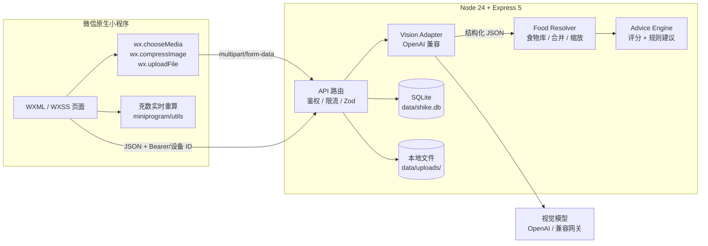
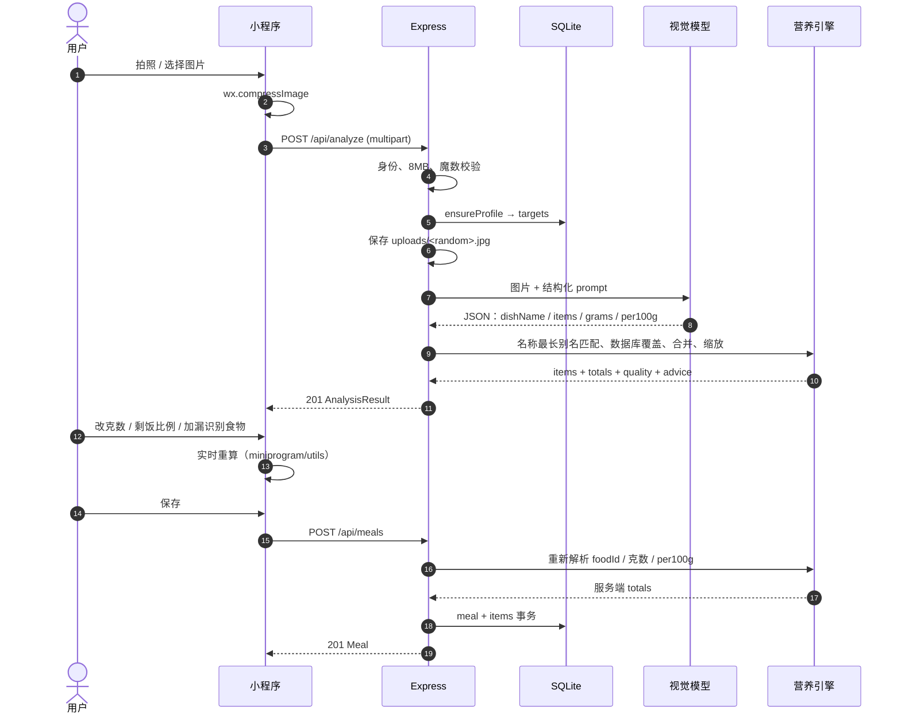
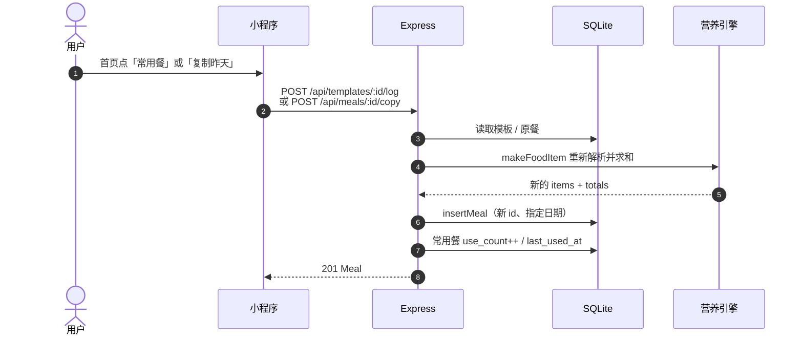
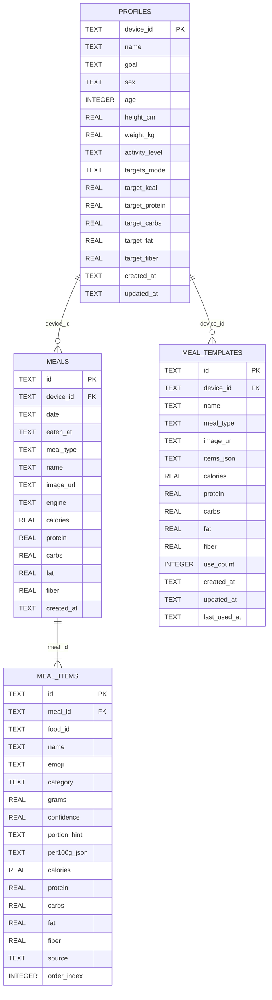

# 食刻 SHIKE — 架构与项目结构

> 版本：v2.0
>
> 定位：AI 食物识别 / 克数校核 / 营养建议，微信原生小程序 + Node API
>
> 最后更新：2026-11

---

## 1. 产品边界

用户只做三件事：

1. 拍一张餐食照片；
2. 确认识别出的食物与实际吃下的克数；
3. 得到热量、营养素和一餐建议，并把记录留在日记里。

系统负责：

- 在小程序内压缩图片；
- 调用视觉模型识别食材、拆解复合菜、估算份量；
- 将模型结果与本地营养库对齐；
- 按可食克数实时计算营养；
- 根据每日目标生成可解释的建议；
- 以「微信 openid」或匿名设备为边界保存每日记录。

**不负责**：疾病诊断、营养处方、实验室级热量测量、社交/排行榜。所有输出都标注为估算。

---

## 2. 关键架构决策

| 决策 | 选择 | 理由 | 代价 |
| --- | --- | --- | --- |
| 交付形态 | 只有微信原生小程序 + API | 单端维护，拍照/上传/分享都在微信内闭环 | 没有桌面端 |
| 微信端 | 原生 WXML / WXSS / JS | 相机、上传、Canvas、tabBar 均为原生能力；无需前端构建链 | 没有现成 Web 组件可复用 |
| 服务端 | Node 24 + Express 5 | Node 原生执行 TypeScript，无服务端构建 | Express 5 生态较轻 |
| 数据库 | `node:sqlite` | 单文件、零服务、WAL、事务；MVP 足够 | 单写者，不适合多实例 |
| 校验 | Zod 4 | 模型 JSON 与用户输入都需要运行时边界 | schema 需跟随 API 演进 |
| 视觉 | OpenAI 兼容接口 | 供应商可替换 | 需处理兼容差异 |
| 识别结果 | 不落库的分析快照 | 用户校核期间可随意改；确认后才保存 | 退出页面会丢未保存分析 |
| 保存 | 服务端重算 | 防止客户端篡改 totals；保证历史一致 | 请求需提交 per100g 与 foodId |
| 图片 | 本地 `data/uploads/` | 零外部依赖，单实例简单 | 多实例需对象存储 |

### 为什么不用 Next.js / Vite SPA

产品没有 SEO、RSC 或桌面端需求，前端就是微信小程序。再维护一套 Web SPA 只会增加构建、样式和测试成本，因此 v2.0 已删除 Web 端。

### 为什么不用 PostgreSQL / Prisma

MVP 是单用户、单实例、低并发。`Store` 是唯一数据访问层，迁移 PostgreSQL 时只需替换这一层，API 契约不变。

---

## 3. 系统架构



### 运行时拓扑

```text
微信开发者工具 / 真机
  └─ miniprogram/ ── wx.request / wx.uploadFile ──▶ 127.0.0.1:8787 Express
                                                         │
                                                         ├─ data/shike.db
                                                         ├─ data/uploads/
                                                         ├─ https://api.weixin.qq.com/sns/jscode2session
                                                         └─ https://<vision-provider>/v1/chat/completions
```

小程序不受浏览器 CORS 限制，但受微信「合法域名」与 HTTPS 约束。真机访问电脑上的 API 要使用局域网 IP；正式环境必须 HTTPS。

---

## 4. 目录结构

```text
.
├─ miniprogram/                  # 微信原生小程序
│  ├─ app.js / app.json / app.wxss
│  ├─ components/
│  │  ├─ progress-ring/
│  │  ├─ macro-bar/
│  │  └─ advice-card/
│  ├─ pages/
│  │  ├─ home/                   # 今日概览、拍照、一键再吃
│  │  ├─ review/                 # 识别结果、克数、剩饭比例
│  │  ├─ food-search/            # 食物库搜索与最近吃过
│  │  ├─ journal/                # 日记录
│  │  └─ goals/                  # 身体数据与目标
│  ├─ utils/
│  │  ├─ api.js                  # wx.request / uploadFile / 登录
│  │  ├─ nutrition.js            # 与服务端共享公式
│  │  ├─ advice.js
│  │  ├─ body.js
│  │  ├─ portion.js              # 份量参照、剩饭折算
│  │  ├─ format.js
│  │  └─ constants.js
│  └─ images/                    # tabBar 图标、logo、示例餐盘
│
├─ server/
│  ├─ index.ts                   # 启动、优雅退出
│  ├─ app.ts                     # Express 路由与中间件
│  ├─ config.ts                  # 环境变量
│  ├─ store.ts                   # SQLite 唯一数据访问层
│  ├─ data/foods.ts              # 80+ 食物营养库
│  ├─ data/demo.ts               # 演示餐盘
│  ├─ services/vision.ts         # 视觉模型适配
│  ├─ services/items.ts          # 结果归一化、合并、求和
│  ├─ services/analysis.ts       # 评分与建议组装
│  ├─ lib/image.ts               # 图片魔数、保存
│  ├─ lib/session.ts             # HMAC 会话
│  └─ tests/                     # node:test
│
├─ shared/                       # 服务端 TS 纯逻辑与类型
│  ├─ types.ts
│  ├─ nutrition.ts
│  ├─ advice.ts
│  └─ body.ts
│
├─ public/images/demo-bowl.jpg   # 演示模式使用；由 Express 提供
├─ scripts/check-miniprogram.mjs # 小程序静态检查
├─ docs/                         # 架构、API、微信、路线图
├─ data/                         # SQLite 与上传图片（gitignored）
├─ project.config.json
├─ tsconfig.server.json          # 只检查 server/shared，避开 DevTools
├─ Dockerfile
├─ .env.example
└─ package.json
```

---

## 5. 小程序架构

### 5.1 页面与状态

没有引入状态库。全局状态只在 `app.js` 的 `globalData`：

```text
profile              当前用户资料与目标
analysis             待保存的识别结果
suggestedMealType    模型推断的餐次
pendingFood          食物搜索页选中的食物
lastSaved            刚保存的一餐，用于日记页 toast
openCameraOnHome     从日记页跳回首页后自动打开相机
ready()              等待微信登录 / 设备 ID 初始化
```

页面职责：

| 页面 | 职责 |
| --- | --- |
| `home` | 今日汇总、拍照/相册、一键再吃、最近记录 |
| `review` | 识别结果、克数编辑、剩饭比例、份量参照、保存 |
| `food-search` | 搜索食物库、最近吃过、把食物加回 review |
| `journal` | 按天查看、删除、再来一份、存为常用餐 |
| `goals` | 昵称、目标、身体数据、自动/手动目标 |

`review` 是唯一持有“未保存识别结果”的页面。保存成功后把 `meal` 放入 `globalData.lastSaved`，再 `switchTab` 到日记。

### 5.2 数据流

1. 首页调用 `wx.chooseMedia` / `wx.chooseImage`；
2. `wx.compressImage` 压缩后 `wx.uploadFile` 到 `/api/analyze`；
3. 服务端返回 `analysis`，小程序 `navigateTo` review；
4. review 在本地用 `miniprogram/utils/nutrition.js` 实时重算；
5. 保存时提交 `foodId`、`grams`、`per100g`，服务端重新计算并落库；
6. 日记与首页通过 `/api/day` 读取当天汇总。

本地重算只用于即时反馈，**不作为可信数据**；服务端保存时一定会重算。

### 5.3 设计系统

- 原生 CSS Design Tokens，定义在 `app.wxss` 的 `page` 变量；
- 主色深绿 `#1B4B37`、背景米色 `#F3F1E8`、强调青柠 `#D9EF7C`；
- 组件：`progress-ring`（Canvas 圆环）、`macro-bar`、`advice-card`；
- 统一 `card`、`btn`、`section-title`、`eyebrow` 等类，页面不重复造按钮。

### 5.4 图片压缩

- 优先 `wx.compressImage({ quality: 78 })`；
- 服务端限制 8MB，并校验 JPG / PNG / WebP 魔数；
- 小程序端不依赖 Canvas 压缩，避免低端机内存问题。

### 5.5 份量与剩饭

`miniprogram/utils/portion.js`：

```text
referencesFor(item)   从 portionHint 提取“半盒 · 150g”，再按品类补“一掌心/一拳头/一勺”
applyRatio(items, r)  用 baseGrams × r 折算整盘
setGrams(item, g, r)  手动改克数时反推 baseGrams = g / r
```

review 页面保存 `baseGrams`（100% 基准）与当前 `grams`，因此：

- 选 50% 后总热量减半；
- 再单独改某一项，不会把比例重复乘一次；
- 来回切换 75% / 50% / 100% 不会漂移。

---

## 6. 后端架构

### 6.1 分层

```text
HTTP 请求
  ↓
app.ts
  ├─ express.json / multer（内存）
  ├─ getDeviceId（Bearer 会话或 x-device-id）
  ├─ analyze 限流（20 次 / 10 分钟 / 身份）
  ├─ Zod 请求校验
  └─ 路由
       ├─ analyze → image 魔数 → saveImage → vision → analysis
       └─ meals / templates → makeFoodItem → itemsTotal → Store.insertMeal
  ↓
services/                  纯业务
  ├─ vision.ts             外部模型边界
  ├─ items.ts              结果归一化
  └─ analysis.ts           组装 + 评分 + 建议
  ↓
store.ts                   SQLite，唯一数据访问入口
```

所有路由用 `asyncRoute` 包装，异常交给统一错误中间件。`createApp({ config, store })` 支持注入临时数据库，API 测试不需要启动真实服务或触碰开发数据。

### 6.2 数据访问

`Store` 使用 `node:sqlite` 同步 API：

- `PRAGMA journal_mode = WAL`；
- `PRAGMA foreign_keys = ON`；
- `insertMeal` 使用 `BEGIN IMMEDIATE / COMMIT / ROLLBACK` 保证 meal 与 items 原子性；
- 所有 SQL 使用 prepared statement 参数绑定；
- 索引：`meals(device_id, date, eaten_at)`、`meal_items(meal_id, order_index)`、`meal_templates(device_id, last_used_at)`。

旧数据库通过 `addColumnIfMissing` 逐列迁移；`meal_templates` 用 `CREATE TABLE IF NOT EXISTS` 增量创建。

### 6.3 静态资源

- `/uploads`：用户照片，文件名 `时间戳-随机 UUID.ext`，`immutable` 缓存；
- `/images`：仅 `public/images/demo-bowl.jpg`，供演示模式使用；
- 没有 Web 页面、`dist/` 或 SPA fallback。

---

## 7. 核心链路

### 7.1 识别 → 校核 → 保存



### 7.2 一键再吃



两条入口共用「复制 items → 服务端重算 → 新建 meal」逻辑；模板只存快照，复制时生成新的 meal id。

### 7.3 失败与降级矩阵

| 情况 | 行为 | 用户看到 |
| --- | --- | --- |
| 未配置 `VISION_API_KEY` | 返回内置演示餐盘 | 黄色提示条「演示模式」 |
| 模型超时 / 网络错误 | 若 `ALLOW_DEMO=true` 降级演示 | 提示「已切换到演示餐盘」 |
| 模型返回非 JSON / 结构错误 | 抛 `VISION_SCHEMA`，走降级 | 同上 |
| 429 限流 | 降级或 429（生产 `ALLOW_DEMO=false`） | 明确错误文案 |
| 图片 >8MB / 非 JPG-PNG-WebP | 400/413/415 | 中文错误 |
| 设备 ID 缺失 | 400 `DEVICE_REQUIRED` | 请求失败 |
| 单身份识别 >20 次 / 10 分钟 | 429 | 「休息 10 分钟再试」 |

---

## 8. 视觉识别设计

### 8.1 Prompt 约束

`server/services/vision.ts` 要求：

- 只输出 JSON；
- 识别 1–10 种可见食物；
- 混合菜按主要食材拆开；
- `grams` 是这一份可食部分熟重，范围 1–3000；
- `per100g` 是每 100g 的热量、蛋白质、碳水、脂肪、纤维；
- `category` 限定 9 类；
- 不确定时降低 confidence，不虚构不可见食物；
- 明显可见的油、酱汁、糖要计入。

请求使用 `detail: "low"` 控制视觉 token 成本，`temperature: 0.2` 降低随机性，`max_tokens: 1600`。

### 8.2 结构化校验

Zod schema 限制：

- dishName ≤40 字；
- items 1–12 条；
- grams 1–3000；
- kcal 0–900 / 100g，蛋白/碳水/脂肪/纤维 0–100 / 100g；
- confidence 0–100，>1 时归一化为 0–1；
- category 非法值自动落到 `other`。

### 8.3 与营养库对齐

`server/services/items.ts` 的 `makeFoodItem`：

1. 如果客户端/模型给出 `foodId`，优先按 ID 命中；
2. 否则用 `resolveFood(name)` 做最长别名匹配（去空格、括号、标点）；
3. 命中营养库 → 使用库中 per100g，`source = "database"`，并沿用库的 emoji/category/份量提示；
4. 未命中 → 使用模型 per100g，`source = "ai"`；
5. 两者都没有 → 通用值 150kcal / 8P / 15C / 6F / 1.5 fiber，避免 0 热量；
6. 同一 `foodId`（或未命中时同名）合并，克数相加，取较高置信度；
7. 名称保留模型识别到的具体做法（如「香煎豆腐」），营养以库值为锚。

### 8.4 为什么保存时重算

客户端可以改克数、加食物、删食物，因此提交的 items 是不可信输入。保存接口会再次：

- 限制 1–20 条；
- 每条 1–3000g；
- 校验 per100g 数值范围；
- 重新按 foodId/名称命中库；
- 重新求和；
- 才写 `meals` 与 `meal_items`。

---

## 9. 营养与建议引擎

### 9.1 营养计算

`shared/nutrition.ts` 与服务端共用纯函数：

```ts
scaleNutrition(per100g, grams) = per100g × grams / 100
sumNutrition(items)            = 逐项求和，1 位小数
macroEnergy(totals)            = P×4 / C×4 / F×9 的供能占比
caloriePercent(consumed, target)
localDateKey(timeZone = "Asia/Shanghai")
shiftDateKey(dateKey, offset)
inferMealType(date)
```

小程序 `miniprogram/utils/nutrition.js` 是同一套公式的 JS 镜像，测试会对比两者结果。

### 9.2 身体数据与目标

`shared/body.ts`：

- BMR：Mifflin-St Jeor；
- TDEE：BMR × 活动系数（1.2 / 1.375 / 1.55 / 1.725 / 1.9）；
- 减脂：TDEE − max(300, 15%)，男性不低于 1500、女性不低于 1200；
- 维持：TDEE；
- 增肌：TDEE + max(200, 10%)；
- 蛋白质：减脂/增肌 1.8g/kg，维持 1.4g/kg；
- 脂肪：0.8g/kg；
- 碳水：剩余热量 / 4；
- 纤维：14g / 1000kcal。

目标页可自动计算，也可手动覆盖；手动输入后 `targetsMode = "manual"`。

### 9.3 餐盘质量分

`buildPlateQuality` 是可解释的相对分数：

```text
基础 43
+ 蛋白质达标度（相对一餐目标 35% 的每日蛋白） × 24
+ 纤维（目标 7g/餐） × 16
+ 蔬菜/水果种类（最多 3 种） × 10
− 脂肪供能 > 42% 时 9 分
− 热量 > 一餐预算 155% 时 8 分
− 热量 < 一餐预算 45% 时 5 分
最终 clamp 到 30–98
```

标签：≥88 非常均衡 / ≥75 相当不错 / ≥60 还有提升空间 / 否则需要调整。

### 9.4 建议规则

`buildMealAdvice` 与 `buildDailyAdvice` 是确定性规则，不依赖模型：

- 没有视觉模型也能给建议；
- 同一输入结果稳定；
- 成本为零；
- 可以单元测试。

一餐建议覆盖：份量偏大、蛋白质不足、纤维/蔬菜不足、脂肪供能过高、搭配均衡、饮水、进食速度。始终返回 3 条，按优先级去重。

每日建议覆盖：热量剩余/超标、蛋白质差距、纤维差距、无记录时的起步建议。

---

## 10. 数据模型



设计说明：

- `profiles.device_id` 当前是设备标识；生产环境应改为 `users.id`，并在服务端建立设备→用户映射。
- `meals` 存汇总值，避免日记列表每次重新求和；`meal_items` 存明细与 `per100g_json` 快照。
- `meal_templates` 存 `items_json` 快照和汇总值；一键记录时仍走 `makeFoodItem` 重新计算。
- `date` 是查询键（YYYY-MM-DD），`eaten_at` 是完整时间；服务端默认使用上海时区。
- `source` 区分 `database` / `ai`；`engine` 记录模型名或「演示引擎」。

---

## 11. API 契约

完整定义见 **[API.md](API.md)**。总览：

```text
GET    /api/health
GET    /api/meta
POST   /api/auth/wechat      { code } → token（未配置返回 501）
GET    /api/profile
PUT    /api/profile
GET    /api/foods?q=
GET    /api/foods?recent=1
POST   /api/analyze          multipart/form-data, field=image
POST   /api/analyze/demo     内置示例餐盘
GET    /api/day?date=YYYY-MM-DD
GET    /api/meals?date=YYYY-MM-DD
POST   /api/meals
POST   /api/meals/:id/copy
DELETE /api/meals/:id
GET    /api/repeat
POST   /api/templates
POST   /api/templates/:id/log
DELETE /api/templates/:id
```

个人接口支持微信会话或开发设备 ID：

```http
Authorization: Bearer <session token>
# 或
x-device-id: 8d1f0c2e-...
```

---

## 12. 安全与隐私

| 风险 | 处理 |
| --- | --- |
| API Key 泄露 | 只存在服务端 `.env`；小程序只拿识别结果 |
| 伪造身份 | 微信登录用 HMAC-SHA256 签名 token；设备 ID 仅用于开发/未配置登录 |
| 图片伪装 | 服务端校验 MIME + 文件魔数，仅 JPG/PNG/WebP |
| 超大文件 | multer 限制 8MB，单文件 |
| 识别滥用 | 单身份 20 次 / 10 分钟内存限流 |
| XSS | WXML 文本绑定自动转义；模型输出不渲染 HTML |
| CSRF | 不使用 cookie；Bearer/自定义 header |
| 路径枚举 | 上传文件名随机 UUID，`/uploads` 仅静态只读 |

隐私注意：

- 照片会保存到 `data/uploads/`，用于记录展示；首页文案应避免“仅用于本次分析”这类不准确表述。
- 删除一餐目前不会删除对应图片文件；上线前应补清理任务。
- 分享卡片默认不包含体重、照片等敏感信息。
- 正式环境应设置 `ALLOW_DEMO=false`，避免模型失败时静默返回演示餐盘。

---

## 13. 性能与可靠性

- 识别是同步请求，通常 3–8 秒；小程序显示 loading，超时 60 秒。
- 图片上传前压缩到合理尺寸，减少流量与视觉 token。
- `analyze` 限流是内存计数，重启清零；多实例时应换 Redis。
- SQLite WAL 支持读写并发，但仍是单写者；事务只包住 meal + items。
- 静态图片使用 `immutable` 缓存；上传文件名不可枚举。
- 错误统一返回 `{ error, code }`，小程序直接展示中文 `error`。

---

## 14. 测试

```text
npm test          18 个测试
npm run typecheck  server/shared 类型检查
npm run check:mini 小程序 JSON / JS / WXSS / 页面文件 / tabBar 图标
npm run check     以上三项
```

覆盖：

- 营养缩放、汇总、宏量供能；
- 餐盘评分与三条建议；
- 身体数据 BMR/TDEE 与目标；
- 视觉模型 JSON 解析；
- 会话签名、篡改、过期；
- 完整 API 流程：识别 → 保存 → 模板 → 复制 → 删除；
- 小程序与服务端营养/身体计算 parity；
- 小程序份量参照与剩饭比例；
- 页面/组件脚本在微信运行时外壳下可加载。

`tsconfig.server.json` 只检查 `server/` 与 `shared/`，并刻意不命名为根 `tsconfig.json`，避免微信开发者工具用内置 TypeScript 4.1 读取 Web 时代的配置。

---

## 15. 部署

### 单实例（推荐 MVP）

```bash
npm ci
npm start
```

- `PORT` 默认 8787；
- 数据持久化在 `data/`；
- 反向代理（Caddy / Nginx）负责 HTTPS；
- 微信后台配置 request / uploadFile / downloadFile 合法域名。

### Docker

```bash
docker build -t shike .
docker run --rm -p 8787:8787 \
  -e VISION_API_KEY=sk-... \
  -e SESSION_SECRET=至少32位随机字符串 \
  -e ALLOW_DEMO=false \
  -v "$(pwd)/data:/app/data" \
  shike
```

镜像只包含生产依赖、`server/`、`shared/` 与 `public/`；不存在 Web 构建产物。

### 平台选择

任何能跑 Node 24 + 持久化磁盘的平台都可以。图片与 SQLite 都要放在持久卷；无状态平台需要先迁移到对象存储 + PostgreSQL。

---

## 16. 扩展到生产

### 16.1 账号与数据

- 把 `profiles.device_id` 改为 `users.id`；
- 设备模式历史记录在登录后归并到微信账号；
- 多成员/家庭账本需要独立的数据模型与隐私设计。

### 16.2 存储

- 图片迁到对象存储 / CDN；
- SQLite 迁 PostgreSQL，`Store` 是唯一需要替换的层；
- 识别任务可改为队列 + 轮询/订阅消息，降低同步等待。

### 16.3 识别质量

- 积累“用户实际克数 vs 模型克数”的评测集；
- 对低置信度条目主动提示确认；
- 支持自定义食物与别名，逐步建立个人食物库。

### 16.4 体验

- 体重趋势、周报、连续记录；
- 订阅消息提醒；
- 营养标签 OCR（比商品条码更适合中国零食/饮料）。

---

## 17. 已知限制

- 视觉模型对复配菜、遮挡、俯拍角度、深色酱汁仍会出错。
- 热量是估算，不替代医疗或营养处方。
- 设备模式无法跨设备同步；微信登录后也不会自动归并旧设备数据。
- 删除餐次不清理图片文件。
- 单实例 SQLite，不适合多实例横向扩展。
- 小程序审核需要真实 AppID、隐私保护指引与合法域名。
