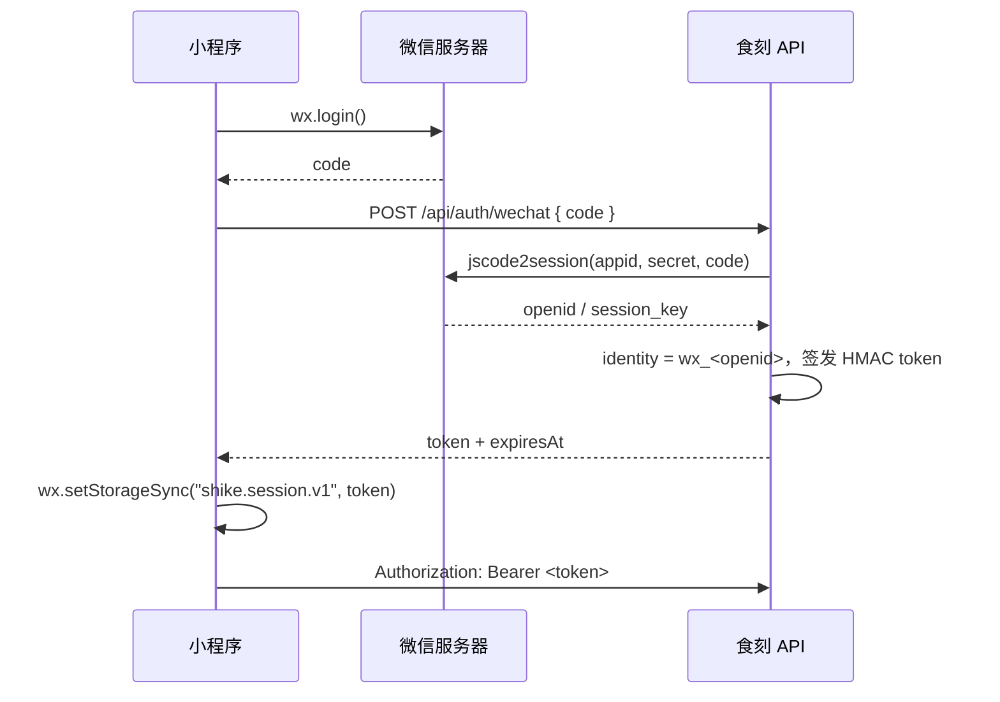

# 微信小程序运行、登录与发布

> 状态：**原生微信小程序客户端已实现**，位于 `miniprogram/`。  
> 直接调仓库根目录的 Express API，共用食物库、营养引擎和 SQLite。v2.0 起不再维护 Web 端，v2.1 增加饮食周报。

---

## 1. 已实现内容

| 能力 | 实现 |
| --- | --- |
| 原生工程 | `project.config.json` + `miniprogramRoot: miniprogram/` |
| 页面 | 今日、确认份量、食物搜索、日记、目标、体重趋势、本周报告，共 7 页 |
| tabBar | 3 个自定义悬浮 tab + 6 张 81×81 图标 |
| 拍照/相册 | `wx.chooseMedia`（旧基础库回退 `wx.chooseImage`） |
| 上传识别 | `wx.uploadFile` → `POST /api/analyze` |
| 克数实时重算 | `miniprogram/utils/nutrition.js`，同步服务端公式 |
| 建议评分 | `miniprogram/utils/advice.js`，服务端规则 JS 版本 |
| 圆环 | Canvas 2D + DPR，自定义 `progress-ring` 组件 |
| 微信登录 | `wx.login` → `POST /api/auth/wechat` → Bearer token |
| 无 AppID 开发 | 自动回落 `x-device-id` 设备模式，全流程可用 |
| 示例餐盘 | `POST /api/analyze/demo`，不需要客户端上传包内图片 |
| 保存/删除 | 服务端重算、按身份隔离、级联删除 items |
| 常用餐 | 存为常用餐、首页一键记录、复制昨天 |
| 份量 | 100/75/50/25% 剩饭折算、可点击的份量参照 |
| 下拉刷新 | 首页、日记、目标、周报 |
| 周报 | 7 天热量/蛋白质柱状图、达标天数、连续记录、上周对比、周总结 |
| 订阅提醒 | 午餐/晚餐/周报/断签，目标页按项授权、续订与开关 |
| 分享 | 分享卡片回到首页；周报分享不含体重和照片 |

**验收状态：** 组件/页面脚本加载、WXML 结构、WXSS 语法、营养与建议一致性均通过自动检查；还需要在微信开发者工具中做一次真实编译与真机预览。常用错误见第 8 节。

---

## 2. 五分钟跑起来

### 2.1 启动 API

```bash
npm install
npm run dev:server
```

API：`http://127.0.0.1:8787`。  
没有 `VISION_API_KEY` 时，识别接口返回内置示例餐盘，其他功能不受影响。

### 2.2 导入项目

1. 打开微信开发者工具 → **导入项目**。
2. 目录选**仓库根目录**（`D:\keep fit`），不是 `miniprogram/`。
3. AppID：
   - `project.config.json` 当前使用真实 AppID；没有权限时换成自己的 AppID。
   - 只预览 UI 也可以使用 `touristappid`，但真机预览和发布必须用真实 AppID。
4. 详情 → 本地设置 → 勾选 **不校验合法域名、web-view（业务域名）、TLS 版本以及 HTTPS 证书**。

### 2.3 走通流程

1. 首页点击「先看看示例餐盘」；
2. 进入确认份量页，修改任一食物克数，热量实时变化；
3. 点击「添加食物」，搜索「牛油果」并添加；
4. 保存 → 自动跳到日记，出现刚才的一餐；
5. 删除记录，确认列表为空。

---

## 3. API 地址

`miniprogram/config.js`：

```js
module.exports = {
  API_BASE: "http://127.0.0.1:8787",
  USE_WECHAT_LOGIN: true
};
```

| 场景 | API_BASE |
| --- | --- |
| 开发者工具 | `http://127.0.0.1:8787` |
| 真机 + 同一 Wi-Fi | `http://<电脑局域网 IP>:8787` |
| 正式发布 | `https://api.your-domain.com` |

正式发布必须：

- HTTPS + 已备案域名；
- 小程序后台配置 `request`、`uploadFile`、`downloadFile` 合法域名；
- 服务器对图片返回 `Content-Type: image/jpeg`，并把域名加入 downloadFile。

---

## 4. 微信登录

### 4.1 流程



### 4.2 服务端配置

根目录 `.env`：

```dotenv
WECHAT_APPID=wx1234567890abcdef
WECHAT_SECRET=你的AppSecret
SESSION_SECRET=至少32位的随机字符串
SESSION_TTL_SECONDS=2592000
```

重启 API。启动日志会显示：

```text
微信登录 已启用
```

未配置时显示：

```text
微信登录 未配置（小程序回落设备模式）
```

### 4.3 两种身份

| 模式 | 身份 | 适用 |
| --- | --- | --- |
| 微信登录 | `wx_<openid>` | 正式用户，跨设备 |
| 设备模式 | `dev_xxx`（本地生成） | 无 AppID 开发、体验 |

设备模式的历史记录不会自动归并到微信账号。上线前应补：

- 首次微信登录时，把当前设备的历史迁到 `wx_openid`；
- 或在 UI 中明确提示“登录后从新账号开始”。

### 4.4 会话失效

- token 默认 30 天；
- 服务端返回 `401 SESSION_INVALID`；
- `utils/api.js` 会清除 token 并用设备身份重试一次；
- 下次进入小程序会重新 `wx.login`。

### 4.5 订阅消息提醒

食材记录类小程序只能用**微信订阅消息**，不能用普通 push。流程是：

```text
目标页打开开关
  → wx.requestSubscribeMessage({ tmplIds: [模板ID] })
  → 用户点“允许”
  → POST /api/reminders/:kind/grant
  → 服务端记一次可发送额度
  → 到点且当天没记录时，服务端调用 subscribeMessage.send
```

**微信公众平台配置：**

1. 登录 [微信公众平台](https://mp.weixin.qq.com/) → 功能 → 订阅消息。
2. 选用或申请“饮食记录提醒”类模板。四条提醒建议各用一个模板：字段结构可以相同，但模板 ID 必须不同，因为微信额度按模板计算。
3. 模板字段建议选 3 个：
   - `thing1`：饮食记录 / 提醒事项（≤20 字）
   - `time2`：记录时间 / 提醒时间
   - `thing4` 或 `thing3`：记录餐次 / 温馨提示（≤20 字，具体 key 看模板详情）
4. 把模板 ID 填进根目录 `.env`：

```dotenv
WECHAT_TEMPLATE_LUNCH=TmplId...
WECHAT_TEMPLATE_DINNER=TmplId...
WECHAT_TEMPLATE_WEEKLY=TmplId...
WECHAT_TEMPLATE_STREAK=TmplId...

# 不同模板的字段 key 可能不同，可以按提醒单独映射
WECHAT_REMINDER_FIELDS={"default":{"title":"thing1","time":"time2","note":"thing3"},"lunch":{"title":"thing1","time":"time2","note":"thing4"}}

# 开发版 developer / 体验版 trial / 正式版 formal
WECHAT_MINIPROGRAM_STATE=formal
```

当前使用的四个模板与字段映射：

| 提醒 | 模板 | 字段映射 |
| --- | --- | --- |
| 午餐 | 饮食记录添加提醒 | `thing1` 饮食记录 / `time2` 记录时间 / `thing4` 记录餐次 |
| 晚餐 | 打卡提醒 | `thing4` 打卡名称 / `time2` 打卡时间 / `thing3` 备注 |
| 周报 | 测评报告查看提醒 | `thing18` 报告名称 / `time8` 测评时间 / `thing7` 温馨提示 |
| 连续记录 | 签到提醒 | `thing1` 活动名称 / `time3` 签到时间 / `thing8` 温馨提示 |

> 模板 ID 请从「我的模板」详情页复制，或调用 `GET https://api.weixin.qq.com/wxaapi/newtmpl/gettemplate?access_token=...` 读取 `priTmplId`。不要从截图手抄：`l` / `1`、`I` / `l`、`0` / `O` 很容易错，错一个字符就会报 `No template data return`。

5. 重启 API，启动日志出现：

```text
订阅提醒 已启用
```

**一次性订阅的限制：**

微信规定每次 `requestSubscribeMessage` 授权只能收到一条对应模板的消息。目标页会显示“剩余 N 次”，发送成功后扣 1 次；用完显示“授权已用完”，用户点“续订”再授权一次。

这不是产品偷懒，是微信订阅消息的规则。不要把它当普通 push 每天静默发送。

**调试：**

- 开发者工具或体验版调试时，把 `WECHAT_MINIPROGRAM_STATE` 改成 `developer` / `trial`，否则正式版消息可能发不到开发版。
- `wx.requestSubscribeMessage` 在 `touristappid` 下不可用，必须使用真实 AppID。
- 服务端需要能访问 `api.weixin.qq.com`；本地开发机通常可以，部署时确认出网。
- 模板字段长度超限、模板 ID 错误、用户未授权都会让微信返回错误；服务端日志只打印 `kind` 和 errcode，不打印 openid。

---

## 5. 目录

```text
miniprogram/
├─ app.js                    # onLaunch: 设备 ID + 微信登录
├─ app.json                  # 7 页面、custom tabBar、全局组件
├─ app.wxss                  # 设计 tokens 与公共样式
├─ custom-tab-bar/           # 悬浮液态玻璃底部导航
├─ config.js                 # API_BASE / USE_WECHAT_LOGIN
├─ utils/
│  ├─ api.js                 # request / upload / auth / API 方法
│  ├─ nutrition.js           # 缩放、汇总、宏量供能
│  ├─ advice.js              # 评分、三条建议
│  ├─ format.js
│  └─ constants.js
├─ components/
│  ├─ progress-ring/         # Canvas 2D 圆环
│  ├─ macro-bar/
│  └─ advice-card/
├─ pages/
│  ├─ home/
│  ├─ review/
│  ├─ food-search/
│  ├─ journal/
│  ├─ goals/
│  ├─ weight/
│  └─ report/
└─ images/                   # tabBar 图标、logo、示例餐盘
```

页面与组件全部使用原生 WXML/WXSS/JS，无 npm 构建步骤。

---

## 6. 与 API / 共享逻辑的一致性

- 使用 `POST /api/analyze`、`POST /api/meals`、`GET /api/day`；
- 同一个食物库（80+ 食材/菜肴）；
- 同一套服务端保存时重算逻辑；
- `miniprogram/utils/nutrition.js` 与 `shared/nutrition.ts` 公式一致；
- `miniprogram/utils/advice.js` 与 `shared/advice.ts` 规则一致；
- `npm test` 中有专门测试：加载所有页面/组件、比对营养计算、校验建议始终三条；周报的统计与接口由服务端测试覆盖。

修改营养/评分规则时，**两处必须同步**。

---

## 7. 发布前检查

- [ ] 真实 AppID 写入 `project.config.json`
- [ ] `WECHAT_APPID` / `WECHAT_SECRET` / `SESSION_SECRET` 已配置
- [ ] `ALLOW_DEMO=false`（线上不展示演示餐盘）
- [ ] API 使用 HTTPS，域名加入 request / uploadFile / downloadFile
- [ ] 图片迁到对象存储/CDN，数据库迁 PostgreSQL（多实例时）
- [ ] 隐私保护指引：相机/相册、照片上传、AI 处理、保存期限、删除方式
- [ ] 用户协议与隐私政策可访问
- [ ] 类目：工具 / 健康管理；避免“治疗、诊断、疗效”等医疗承诺
- [ ] 设备模式数据归并方案
- [ ] 真机：iOS / Android 各测一遍拍照、上传、保存、删除
- [ ] 弱网/断网提示
- [ ] 体验版全流程验收后提交审核

---

## 8. 常见问题

### 打开就提示“请求失败/网络连接失败”

- API 没启动：`npm run dev:server`；
- 真机用了 `127.0.0.1`：手机上的 localhost 是手机自己，改成电脑局域网 IP；
- 没有勾选「不校验合法域名」；
- 正式环境域名没加入 request 白名单。

### 图片不显示

- `/uploads/...` 是相对路径，小程序通过 `api.assetUrl()` 补上 `API_BASE`；
- 正式环境使用 HTTPS，图片域名要加入 downloadFile；
- 检查 `API_BASE` 是否带协议与端口。

### 微信登录返回 501

服务端没有配置 `WECHAT_APPID` / `WECHAT_SECRET`。  
这是预期行为，小程序会自动回落到设备模式。需要真实登录时补配置并重启。

### 微信登录返回 401

- AppID 与 AppSecret 不匹配；
- 使用了 `touristappid` 但服务端配置了真实 AppID；
- code 已过期/被使用。

### 圆环是空白

- 自定义组件 `progress-ring` 的 canvas 需要在组件 ready 后查询节点；
- 低版本基础库可能不支持 Canvas 2D，把 `project.config.json` 的 `libVersion` 调到 2.30+；
- 真机截图确认不是深色文字叠在深色背景上。

### 点击拍照没反应

- 开发者工具需要允许摄像头权限；
- 真机需要在系统设置中允许微信访问相机/相册；
- `wx.chooseMedia` 在低版本基础库不可用时会自动回退 `wx.chooseImage`。

### 真机上传很慢

- 小程序端使用 `sizeType: ["compressed"]`，并在上传前调用 `wx.compressImage({ quality: 78 })` 再压一次；
- 如果仍然慢，可在服务端加 `sharp` 限长边，或把图片改为对象存储直传。

---

## 9. 后续可选增强

- 相机页自定义取景框与份量参照；
- 本地缓存今日 summary，弱网先读缓存；
- 微信订阅消息（记录提醒）；
- 分享卡片带餐食图片；
- 历史趋势图（Canvas 折线）；
- 账号数据归并；
- 食物库后台管理。
